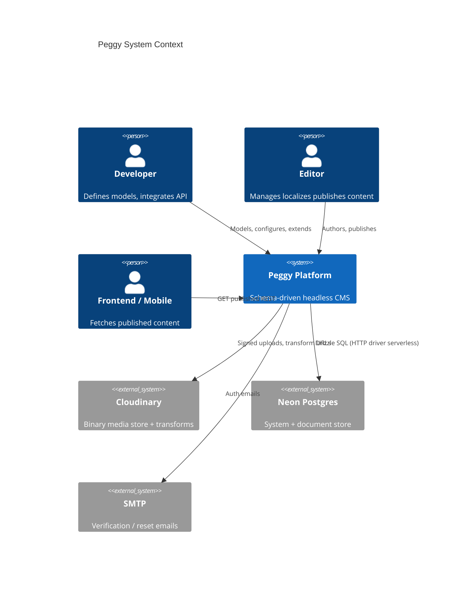
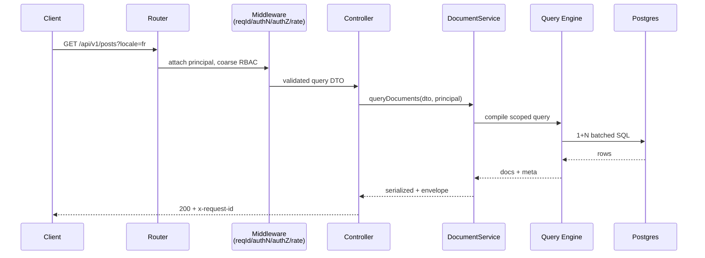
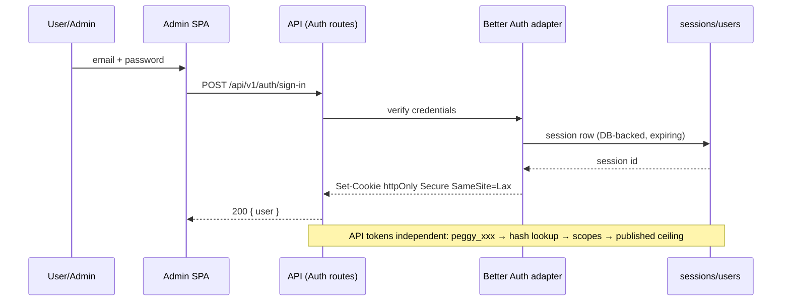
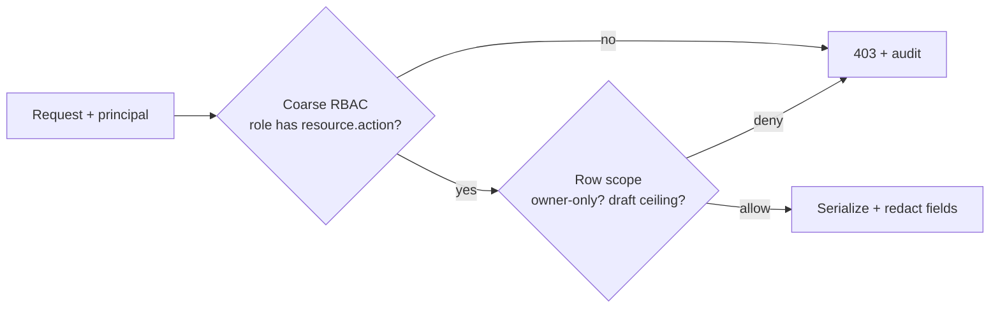
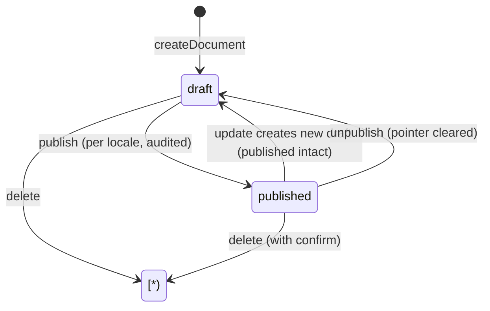
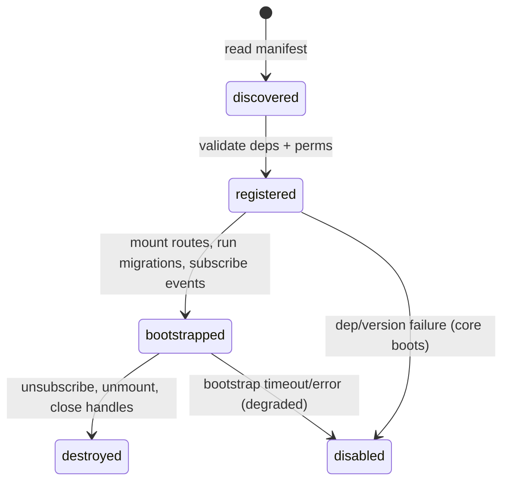
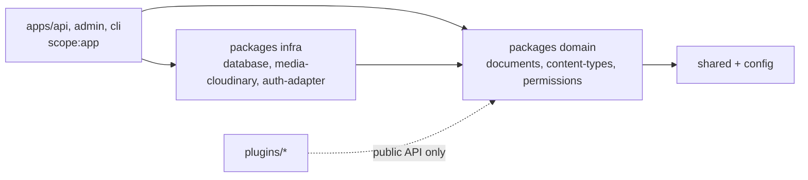

# Peggy CMS — Technical Architecture Document
**Document:** `docs/02-technical-architecture.md`
**Version:** 0.2.0 — OQ-01…OQ-06 resolved, spike complete
**Spike report:** `docs/00-better-auth-spike.md`
**Companion docs:** `01-product-requirements.md` (what), `03-database-model.md` (tables)

---

## 1. Architecture Overview

Peggy is a modular monolith: one deployable API (`apps/api`, Express + `serverless-http`), one static admin SPA (`apps/admin`, Next.js export), one Postgres database (local PG for dev, Neon for prod), Cloudinary for binary media storage. All content behavior derives from a versioned Schema Registry. All reads/writes flow through the Document Service + Query Engine. No layer bypasses.

```
 developer defines schema ──▶ Schema Registry (versioned metadata)
        │                            │ Zod validators + TS types + OpenAPI fragments
        ▼                            ▼
 Admin SPA (schema-driven)   Document Service (transactions, locale, publish, relations)
        │ REST /api/v1                │ Repositories (Drizzle, system tables + JSONB docs)
        └──────────────▶ Express routes → middleware → controllers → services ──▶ Postgres/Neon
                                │ events (outbox) ──▶ webhooks (async)    media via signed Cloudinary
```

Why a modular monolith and not microservices: team size, transactionality (publish must atomically touch documents + versions + relations + audit), and serverless cost. Distribution boundary, if ever needed, is at the async worker (webhooks/scheduler), not at CRUD.

## 2. Architectural Principles

P-01 API never touches DB (lint-enforced; controllers take services via DI, never `db`).
P-02 Domain never imports Express, Drizzle, Next, Cloudinary, Better Auth (arch test fails build).
P-03 Core never imports Cloudinary SDK (only `StorageProvider` port).
P-04 Core never imports Next.js (admin is a pure API consumer).
P-05 Plugins use `definePlugin` public API only; `core/internal/*` is unresolvable outside core.
P-06 Schemas are source of truth; Zod/TS/OpenAPI/admin forms generated, never hand-duplicated.
P-07 Admin is schema-driven (no per-type forms; CI greps for `PostForm`-style components).
P-08 AuthN ≠ AuthZ (separate services, tables, tests).
P-09 All persistence behind Repository interfaces; Drizzle confined to `packages/database`.
P-10 No microservices in MVP; one API + one async worker design (outbox ready, worker minimal).
P-11 Modular-first; P-12 no premature abstraction (no generic "entity framework" beyond documents); P-13 no cycles (`nx enforce-module-boundaries`); P-14 infra outside domain; P-15 every ADR records reason.

## 3. System Context (C4 L1)



External actors only touch REST + Admin SPA. No direct DB. Cloudinary binaries never proxy through API in MVP.

## 4. High-Level Architecture (Containers, C4 L2)

```mermaid
flowchart TB
subgraph Client
A[Admin SPA<br/>Next.js static export]
F[Web/Mobile frontends]
end
subgraph Peggy Deploy
R[Express App<br/>routes/middleware/controllers]
S[Application Services<br/>Document / Publish / Media / AuthZ]
G[Schema Registry<br/>versioned metadata + Zod gen]
Q[Query Engine<br/>filter/sort/page/populate/locale/status]
E[Event Bus + Outbox]
PL[Plugins<br/>namespaced, public API]
end
DB[(Postgres / Neon<br/>system tables + document_versions JSONB)]
CL[Cloudinary<br/>binaries]
A -->|/api/v1 JSON| R
F -->|Bearer token, published only| R
R --> S
S --> G
S --> Q
S --> E
R <--> PL
S --> DB
Q --> DB
E -.async.->|webhooks| F
A -.signed upload.-> CL
S -->|sign + metadata| CL
```

Deploy units MVP: (a) API handler (serverless function or container running same `createApp()`), (b) Admin static bundle (CDN), (c) Postgres (Docker local / Neon prod), (d) Cloudinary SaaS. No Redis/queue in MVP; outbox tables hold async intent.

## 5. Application Architecture (Layers)

```
HTTP (Express) ── DTOs only
  │ Router: path → controller; param validation (Zod); no business logic
  │ Middleware: requestId → logger → cors → authN (attach principal) → authZ (coarse check) → rateLimit
  │ Controller: parse/validate (Zod) → call one service method → serialize → envelope; maps domain errors → HTTP codes
  ▼
Application Services (orchestration + transactions): DocumentService, PublishService, MediaService,
  AuthService, RBACService, LocaleService, WebhookService, AuditService. Own `withTransaction`, event emission.
  │ depend on ports (interfaces), never on Drizzle/Express
  ▼
Domain / Core: Schema Registry model, Document aggregate rules (locale×status×version invariants),
  permission evaluation (RBAC + owner-only), publish state machine, fallback policy. Pure TS, no I/O.
  ▼
Infrastructure: Drizzle repositories, Neon/pg adapters, Cloudinary adapter, Better Auth adapter,
  SMTP sender, logger, config. Implements ports.
```

Why each layer exists: Router isolates URL shape from logic (versioning cheap). Middleware isolates cross-cutting auth/rate concerns from controllers. Controllers isolate HTTP (status codes, envelopes) from transactions. Services isolate multi-repo atomicity + events from SQL. Repositories isolate SQL dialect from rules. Domain isolation is what lets us swap Express→Hono or Neon→RDS without rewriting publish logic.

## 6. Backend Architecture (Module Map)

`apps/api` is a thin composition root: `createApp(deps)` wires `packages/*`. Real logic lives in packages with strict direction:

```
@peggy/shared (types, errors, envelope, pagination) ← imported by all, imports none
@peggy/config ← env parsing (Zod), imports shared only
@peggy/database ← Drizzle schemas (system tables), migrations, DbClient port + neon-http/pg adapters
@peggy/auth ← AuthPort, Better Auth adapter (verify), session attach, password-reset orchestration
@peggy/permissions ← roles/permissions model, evaluate(principal, resource, action, row) + owner-only
@peggy/content-types ← Schema Registry CRUD, versioning, Zod generator, OpenAPI fragments
@peggy/documents ← DocumentService, PublishService, Query Engine, relation resolver, fallback policy
@peggy/media ← MediaService + StorageProvider port + Cloudinary adapter
@peggy/i18n ← locales CRUD, fallback chains, per-locale unique scoping helpers
@peggy/events ← typed bus + outbox writer + dispatcher interface
@peggy/webhooks ← subscriptions, signing, retry, delivery log
@peggy/plugins ← manifest, lifecycle, sandbox loader, capability registry
@peggy/api ← routes/controllers/serializers/middleware (depends on all above, nothing depends on it)
```

Dependency rule enforced by Nx tags: `scope:domain` (`shared, content-types, documents, permissions, i18n, events`) cannot import `scope:infra` (`database, auth-adapter, media-cloudinary`) or `scope:app` (`api, admin`). Cycles fail `nx run-many`.

If this looks like many packages: it is deliberate — each maps to a §21 test boundary and a future extraction point (e.g., webhooks → worker) without a rewrite.

## 7. Admin Architecture (Schema-Driven SPA)

Next.js in **static export / SPA mode** (no SSR data fetching; `output: 'export'`). All screens render from two runtime sources: (a) Registry schemas (`GET /api/v1/content-types/:name` → JSON Schema derived from Zod), (b) content via content REST. Shared `@peggy/admin-schema` client: `schema → form fields`, `schema → table columns`, `zodError → inline messages`.

```
Registry JSON ──▶ Form Renderer (react-hook-form + zodResolver, dynamic)
              ──▶ Table Renderer (server pagination, filters mirror Query Engine ops)
              ──▶ Relation/Media pickers (paginated search)
              ──▶ Builder Canvas (field palette → Registry mutations, version diff preview)
```

Builder→backend: `POST/PATCH /api/v1/content-types` (admin session + `content-types.manage`); response includes `schemaVersion`; admin invalidates `react-query` cache key `schema:<type>`; manager screens refetch. Optimistic UI allowed for drafts, never for schema mutations (confirm + version display).

Why SPA not SSR: admin sits behind auth; SSR doubles cold starts and couples deploy to Node server; static bundle on CDN is cheaper and cacheable, and content preview uses client-side `preview` token calls.

## 8. Content Model Architecture

Kinds: `collection` (many documents), `single` (singleton per locale), `component` (embedded, no identity, no API routes), `dynamicZone` (ordered `[{ __component, data }]`). Fields per PRD §10. Relations are first-class metadata (`sourceType, targetType, kind, inverse, onDelete`), resolved at read time by Query Engine, stored as `document_relations` edges (see DB doc), never as denormalized JSON pointers alone (edges enable restrict/cascade + reverse lookup).

Component vs relation: component = composition (lifecycle bound to parent, no independent publish); relation = association (independent lifecycle, own permissions). Dynamic zone = ordered composition of heterogeneous components.

## 9. Schema Registry

Tables: `content_types, content_fields, components, content_type_components` (full DDL in DB doc). Behavior: writes validate (reserved names, relation targets exist, localized only if type localized); every mutation → `schema_versions` row + `version` bump; Zod schema compiled and cached by `(type, version)`; OpenAPI fragment regenerated; `schema.updated` event emitted; documents carry `schema_version` for lenient reads (`meta.schemaStale` when behind). Breaking-change classifier (type narrowing, new required/unique, relation retarget) forces `?confirmBreaking=true`. Registry reads are the hottest path — cached in-memory per instance with `version` check (no Redis in MVP; serverless instances refetch on version mismatch header).

## 10. Document Service

Aggregate root: `Document (documentId, contentType)` → `DocumentLocale (locale, draftVersionId, publishedVersionId)` → `DocumentVersion (version, status, data, createdBy)`. Invariants enforced in service transaction: exactly-one draft pointer per (doc, locale); published pointer nullable; publish only from existing draft version; single types enforce one document per (type, locale); delete cascades per relation policy; every mutation writes `audit_logs` + outbox event in same transaction.

Methods (illustrative signatures): `createDocument(type, locale, data, actor)`, `updateDraft(documentId, locale, patch, actor)`, `publish(documentId, locale, version?, actor)`, `unpublish(documentId, locale, actor)`, `deleteDocument(documentId, actor)`, `restoreVersion(documentId, locale, version, actor)`. All take validated DTOs, return serialized document + meta.

## 11. Query Engine

Single choke point for all list/get queries. Input: `{ type, locale, fallback, status, filters, sort, page/pageSize|cursor, fields, populate, q }`. Pipeline: (1) authZ scope injection (public → `published IS NOT NULL` + locale fallback; preview → optional drafts), (2) filter compile (allowlisted ops → Drizzle predicates over JSONB `data` + extracted columns + GIN for `q`), (3) sort/paginate (offset default, cursor for `>10k` collections), (4) fetch versions + resolve relations (batched, depth ≤3, cycle guard), (5) field projection + redaction, (6) meta assembly (`total, page, fallback flags, schemaStale, truncated`).

Performance contract: ≤1+N_populates SQL (batch loads, no per-row queries); `pageSize ≤100`; `filters ≤20 keys`; GIN index on `data` + btree on extracted `(contentType, locale, status, slug, publishedAt)`; `EXPLAIN` CI gate on seed.

## 12. API Architecture

Prefix `/api/v1` (D5). Resource naming plural kebab (`/posts`, `/site-settings` for singles — no `:id`). Methods: GET list/get, POST create, PATCH update (partial, JSON Merge Patch semantics on `data`), DELETE remove, `POST /:id/publish|unpublish`, `POST /bulk-*` for batch. Status codes: 200/201/204, 400 validation/envelope, 401 unauthenticated/expired, 403 forbidden/scope/draft-denied, 404 (incl. locale-missing without fallback), 409 conflict (unique/relation/singleton), 413 payload, 422 semantic validation, 429 rate. Errors: `{ error: { code: SNAKE_UPPER, message: human, details?: [{ path, message, code }], requestId } }`. Auth: `Bearer` session-JWT or `peggy_` API token (prefix-routed). Versioning: URL major; additive changes minor without bump; OpenAPI at `/api/v1/openapi.json` generated from Registry + route metadata. Controllers are ~30 lines: validate → service → serialize; no `if (role)` logic outside middleware/service.

Request lifecycle diagram:



## 13. Database Architecture

Summary; normative DDL in `03-database-model.md`. Strategy (D1): system tables relational + versioned migrations (Drizzle); content payloads in `document_versions.data JSONB` with GIN + extracted queryable columns (`slug`, `publishedAt`, numerics flagged `indexed:true`); edges in `document_relations`; no per-type DDL in MVP. Transactions: every write = one DB transaction (service owns `BEGIN/COMMIT`, repos take `tx`). JSONB discipline: JSON only for schemaless content + conditions + settings; never for FKs, money, or query-critical uniques (those are extracted columns). Migrations: `drizzle-kit` for system tables; content schema changes are data rows, not migrations; plugin tables namespaced with own migration ledger. Connection: `DbClient` port with `NeonHttpAdapter` (fetch, serverless-safe, no sockets) default in handler and `PgPoolAdapter` for long-lived dev/worker; pool size env-tuned, statement timeout set, no in-request DDL.

## 14. Authentication Architecture (Better Auth + Tokens)



Human authN (Better Auth) — spike complete (`docs/00-better-auth-spike.md`): email+password, verification, reset, session CRUD, expiry/rotation — all behind `AuthPort` so domain never imports the library. Hashing: built-in scrypt default (Node native; Argon2id custom `hash`/`verify` reserved post-MVP). Lifetimes: `expiresIn` 7d, `updateAge` 24h, 5-min JWE cookie cache (hot reads skip DB on Lambda). Express: `toNodeHandler(auth)` at `/api/auth/*` before `express.json()`, CORS first (Express v5: `{*any}` wildcard). Drizzle adapter `@better-auth/drizzle-adapter` (`provider: "pg"`); Peggy `users`/`sessions` tables ARE the Better Auth `user`/`session` tables via `additionalFields`. Organization plugin NOT installed (D2 single-project; adoption path recorded). Residual C-01…C-05 code confirmations (Neon-HTTP interop, option shapes, Lambda routing, cookie interop, load assertion) gate kickoff — fallback is pooled `pg` for auth routes, no domain change. Programmatic access: `api_tokens` with `prefix + sha256(secret+pepper)`, scopes = permission strings, `expiresAt`, `lastUsedAt` update (async, non-blocking), revocation list checked per request. Admin sessions use cookies + CSRF; API uses Bearer. Plugin SSO via `auth.extend()` hook, never direct session-table writes.

## 15. Authorization Architecture

Two-tier: (Tier 1, middleware) `requirePermission(resource.action)` from route metadata → 403 fast-fail; (Tier 2, service/query) row/field scoping — `WHERE createdBy = me` injection for owner-only, field redaction at serialization, `status=draft` ceiling for public scopes. Data: `users ↔ user_roles ↔ roles ↔ role_permissions ↔ permissions(resource, action, conditions JSONB)`. MVP evaluates `conditions: null | { owner: true }`; anything else → deny + `CONDITION_NOT_SUPPORTED` (audited). Publish/unpublish are separate actions; `read` never implies `readDraft`. Tests: matrix (role × own/other × draft/published × locale) is a required CI fixture.



## 16. Media Architecture

`MediaService → StorageProvider { signUpload, confirmAsset, destroy, transformUrl, parseCallback } → CloudinaryProvider`. Upload: `POST /media/sign` (authZ `media.upload`, MIME/size/quota check → signed params, 10-min expiry) → browser direct PUT to Cloudinary → `POST /media` confirm (server HEADs provider URL, magic-byte/MIME cross-check, writes metadata row). Read: `transformUrl(asset, preset)` builds Cloudinary fetch URL at serialization (provisional MVP presets: `thumb, card, hero, original`; `f_auto,q_auto` defaults — exact list finalized after verifying the selected Cloudinary plan's transformation limits during implementation, OQ-02). Folders hierarchical; delete blocked when referenced (409 + `references[]`) unless `force` + `media.manage`. Variants are URL-level, not rows (except optional `derived` cache post-MVP). Core imports zero Cloudinary symbols — adapter package only.

## 17. i18n Architecture

Document-per-locale (D3): `documents (documentId, contentType)` → `document_locales (documentId, locale, draftVersionId, publishedVersionId, publishedAt)` → `document_versions (data)`. Locales table: `code BCP47 PK-ish unique, name, isDefault (exactly-one partial unique), isActive, direction, fallbackChain[]`. Reads: `locale` param (default default-locale), `fallback` boolean (default true public / false admin); fallback walks `fallbackChain` then default; `meta` always reports `{ locale, requestedLocale, fallback, fallbackLocale }`. Writes: missing non-default-locale document auto-created from default-locale draft data (copies, then independent). Uniques: `unique_per_locale` default (partial unique index on `(contentType, locale, normalizedSlug)`); `unique_global` opt-in separate index. Relations resolve per request locale with `meta.relationFallback` flags.

## 18. Draft/Publish Architecture

State machine MVP: `draft ⇄ published` per locale pointer. Publish txn: lock locale row → validate draft against active schema → set `publishedVersionId`, `publishedAt/FirstPublishedAt` → audit + `document.published` outbox row → commit → return 200 (idempotent if same version). Unpublish: clear pointer, retain history. `scheduledAt` columns exist but MVP returns `202 scheduled` + outbox row for future worker (no timers in handler). Leak prevention: Query Engine injects `publishedVersionId IS NOT NULL` for any principal lacking `readDraft`/publish scope; public token path hard-codes it regardless of query params; CI fixture asserts 0 draft rows for public token.



## 19. Plugin Architecture

Entry: `definePlugin({ name, version, peerPeggy, permissions, contributions })`. Manifest declares routes (`/api/v1/<plugin>/*` only), services (DI tokens), admin slots (`pages, nav, widgets, settingsSchema`), events subscribed, content types (`plugin_<name>__*`), tables (`plugin_<name>_*` + migrations). Lifecycle `discover → register (pure, no I/O) → bootstrap (idempotent, timeout 10s, failure isolates plugin, core boots degraded) → destroy`. Isolation: separate router mount, own migration ledger, permission grants explicit in admin, no `core/internal` imports (package exports map blocks it), admin extensions via slot props only. Versioning semver + `peerPeggy` range checked at register; mismatch → disabled + health flag.



## 20. Event Architecture

Two distinct mechanisms: **Lifecycle hooks** (synchronous, in-transaction function calls: `beforeCreate/afterPublish` — can veto/transform, must be fast, no I/O) vs **System events** (async, outbox-backed: `document.published`, `media.deleted` — at-least-once, consumed by webhooks/plugins/analytics). Flow: service writes business rows + `outbox (eventId, type, payload, actor, timestamp)` in same txn → committer returns to client immediately → dispatcher (MVP: inline after-commit + best-effort; post-MVP: dedicated worker polling `outbox`) delivers to subscribers. Plugins subscribe via manifest (`events: { 'document.published': handler }`), never by importing the bus internals.

## 21. Webhook Architecture

Subscriptions: `webhooks (id, url, events[], secret, active, timeoutMs, retryPolicy)`; deliveries: `webhook_deliveries (eventId idempotency key, webhookId, attempt, statusCode, latencyMs, error, nextRetryAt)`. Delivery **async only** (never blocks publish response): sign `HMAC-SHA256(timestamp.body)` → `X-Peggy-Signature, X-Peggy-Timestamp, X-Peggy-Event-Id` → POST with timeout (default 10s) → exponential backoff 3 attempts MVP → log each attempt → dead-letter flag after exhaustion. SSRF guard: URL allowlist validation (block localhost/metadata-link-local in prod), response size cap, redirect limit 2. MVP worker: scheduled AWS Lambda polling outbox/`webhook_deliveries` (OQ-05; Inngest deferred unless volume/complexity justifies it) + after-commit best-effort inline attempt + manual replay endpoint (`POST /webhooks/:id/replay`).

## 22. CLI Architecture (thin MVP)

`apps/cli (peggy)`: `doctor` (env/DB/Cloudinary reachability), `migrate` (system migrations up/down/status), `seed` (roles/locales/demo), `--help` versioned. `generate/*, create, import/export` exist as stub commands returning `NOT_IMPLEMENTED` + API alternative pointer — never half-scaffolding. Design rule: CLI wraps stable service APIs (same Zod DTOs), emits no source-of-truth code; full `create-peggy-app` post-core. Implemented with `commander` + `@peggy/config`, tested as black-box against ephemeral PG.

## 23. Nx Monorepo Architecture

```
peggy/
 apps/api (scope:app, tags: deployable) → depends on packages/*, nothing depends on it
 apps/admin (scope:app) → only @peggy/shared + API JSON (no server imports)
 apps/cli (scope:app)
 packages/{shared,config,database,auth,permissions,content-types,documents,media,i18n,events,webhooks,plugins,api} (scope:domain|infra)
 plugins/<name> (scope:plugin, own lint + migrations)
 docker/, docs/{01,02,03 + adrs/}, tests/e2e
```

Tags + `enforce-module-boundaries`: `domain !→ infra,app`; `infra !→ app`; `app !→ app`; plugins `!→` anything except declared `peer` packages. Affected builds/tests via Nx cache; e2e in `tests/` runs API + Admin + PG fixture. Dependency graph rule of thumb: arrows point inward to domain; `api` is the outermost ring.



## 24. Docker Architecture

Two files: `docker-compose.dev.yml` (Postgres 16 + API hot-reload + Admin dev + seed; Cloudinary = real dev cloud via env, never mocked binaries) and `Dockerfile.api` (+ `Dockerfile.admin` static) for prod parity. Neon is **never** run locally — dev uses container PG, prod/preview use Neon annoncé via `DATABASE_URL` (HTTP driver) — avoids branch-per-dev cost and offline dependence. Env: `.env.development` (local PG, dev Cloudinary, lax CORS) vs prod (Neon URL, restricted CORS, Secure cookies, Sentry DSN reserved). `peggy doctor` validates all required vars at boot with actionable messages.

## 25. Configuration Architecture

Single `@peggy/config` package: Zod-parsed env (`DATABASE_URL, BETTER_AUTH_SECRET, CLOUDINARY_*, ADMIN_URL, API_URL, CORS_ORIGINS, RATE_LIMITS_*, DEFAULT_LOCALE, MAX_UPLOAD_*`), typed `config` singleton, per-env defaults, `doctor` rules. No `process.env` reads outside this package (lint rule). Secrets via env/secret-manager only; logged config redacts `*SECRET*,*KEY*,*TOKEN*`.

## 26. Error Handling

Domain errors are typed (`NotFound, ValidationFailed, Forbidden, Conflict, DraftDenied, LocaleMissing, RelationRestricted, ...`) with `code` + `details`; controllers map 1:1 to HTTP via table (no `if/else` chains per route); envelope `{ error: { code, message, details, requestId } }`; `5xx` sanitized in prod (`INTERNAL_ERROR` + requestId; stack to logs only); Zod errors normalized to `details[{ path, message }]`; idempotency keys on publish/bulk/webhook-replay prevent double-apply.

## 27. Observability (MVP-practical)

Structured JSON logs (`level, msg, requestId, actor?, route, latencyMs, dbMs, plugin?`; reserves `traceId/spanId`); `x-request-id` inbound/outbound; `/health` (unauth, version) + `/ready` (DB ping + registry load + plugin states); audit logs (domain actions, 12-month retention per OQ-04, redacted at write, config-driven window) + webhook delivery logs (infra); DB slow-query log (>200ms) + Neon dashboard (prod); admin error boundary with requestId display. Metrics/APM/tracing backends deferred but log shape is OTEL-compatible.

## 28. Security Architecture

Boundaries: authN (Better Auth adapter) → authZ middleware → service row-scope → serializer redaction → audit. Controls per PRD SR-01…SR-15: deny-by-default; sessions httpOnly/Secure/Lax + rotation; tokens hashed; Zod everywhere in, serializers out; Drizzle params only; richtext sanitized at render contract; CSRF on cookie mutations; CORS allowlist; per-target rate limits (OQ-03 — Lambda 5/100/30, Vercel 10/200/30, Fly.io 5/150/30 auth/public/publish per min; Postgres-backed counters); scrypt-default password hasher (spike-verified); upload allowlist + caps + cross-check; webhook SSRF guards + HMAC; secrets redacted; audit append-only. Threat notes: draft-leak (query predicate, CI gate), mass-assignment (DTO allowlist from schema), relation-escalation (`populate` allowlist + depth), plugin-escape (export-map + permission grants), token replay (short expiry + revocation check).

## 29. Testing Architecture

Pyramid: unit (domain: publish machine, fallback, permission eval, filter compiler — ≥80% branch on those modules) → integration (API + ephemeral PG: FR matrix, draft-leak gate, owner-only, fallback, signed-upload mock) → contract (OpenAPI snapshot + TS client compile) → e2e (Admin happy paths: builder→publish→consume; `tests/e2e`). Fixtures: `en/fr` locales, Author/Post/Category, roles matrix, draft-only docs. Gates: draft-leak `0 rows`, arch tests (no domain→infra imports), OpenAPI coverage 100% routes, `npm audit` high = fail. Non-goals: load-cert in MVP (budgets documented, k6 smoke only).

## 30. Deployment Architecture

Targets: serverless (Lambda/Vercel/Neon stack: handler = `serverless-http(createApp())`, Neon HTTP driver, admin static on CDN) or container (Fly/Render: same `createApp().listen()`, `pg` pool). Same artifact, env-selected adapter — no code fork. Cold-start budget p95 ≤2.5s scale-from-zero (lazy plugin bootstrap, registry cache, no per-boot DDL). Background (MVP): scheduled AWS Lambda worker polling outbox + `webhook_deliveries` (OQ-05) + after-commit inline attempt + manual replay; Inngest only if volume/complexity justifies it. Rollback: system migrations reversible; content schema changes are data (forward-compatible lenient reads); plugin disable is a flag, not a deploy.

## 31. Scalability Strategy

Content types ≤500 (registry cached, no per-type tables); documents ≤500k MVP (JSONB + GIN + extracted cols; partition `document_versions` by `createdAt` when >1M); rps ~100 sustained/unit (stateless handler + Neon autoscale; sticky nothing); plugins ≤20 (budgeted boot +10s timeout each, parallel bootstrap); admin static (CDN, zero server). Escape hatches (post-MVP, designed now): extracted-column widening → materialized views → per-type tables; read replicas via `DbClient.read` split; Redis for registry/pub-sub only when measured.

## 32. Dependency Boundaries (enforcement)

| Rule | Enforced by |
|---|---|
| controllers ↛ db/drizzle | ESLint `no-restricted-imports` in `packages/api` |
| domain ↛ express/drizzle/next/cloudinary/better-auth | arch test (`dependency-cruiser`) + `nx enforce-module-boundaries` |
| core ↛ cloudinary SDK | package exports + import lint |
| plugins ↛ `core/internal` | `exports` map (no export) + runtime warning |
| config: no `process.env` outside `@peggy/config` | lint rule |
| no cycles | `nx graph` CI check, build fails |

## 33. Architectural Risks (residual, with mitigations)

R-01 JSONB query ceiling at high cardinality → extracted cols + GIN now, materialization path reserved. R-02 Neon scale-to-zero latency → warmed preview for demos, budget documented, local PG for tests. R-03 Better Auth integration risk → spike complete; C-01…C-05 confirmations gate kickoff; AuthPort + fallback retained. R-04 Owner-only insufficient later → `conditions` column reserved, deny-by-default on unknown. R-05 Plugin boot latency → parallel + timeout + degraded mode. R-06 Admin dynamic-form complexity → shared renderer, no fork per type. R-07 Outbox without worker (MVP replay manual) → documented SLO, worker interface frozen.

## 34. ADRs (summaries; full records in `docs/adrs/`)

- **ADR-001 Nx monorepo:** keep Nx (≥6 pkgs, generators for CLI future, affected graphs). Alt: Turborepo lighter but weaker generators. Tradeoff: config overhead. Consequence: tags + boundary lint mandatory.
- **ADR-002 Express:** keep for MVP velocity behind `createApp()` isolation; exit path to Hono/Fastify preserved. Alt: Hono (colder-start, edge) — revisit if p95 cold >budget. Tradeoff: heavier cold + no built-in validation (Zod covers).
- **ADR-003 serverless-http:** keep as thin adapter; sync CRUD only; uploads/deliveries async. Alt: containers-only — rejected (preview envs need serverless). Consequence: Neon HTTP driver + signed uploads mandatory.
- **ADR-004 PostgreSQL:** primary DB for JSONB+GIN+transactions+RLS future. Alt: Mongo (weaker relations/txn). Consequence: JSONB discipline + extracted cols.
- **ADR-005 Neon:** prod/preview for branching + HTTP driver; local PG for dev/test. Alt: RDS/Supabase. Tradeoff: scale-to-zero latency + egress. Consequence: dual `DbClient` adapters.
- **ADR-006 Drizzle:** system tables + typed queries; dynamic content via JSONB repos, not per-type tables. Alt: Prisma (worse dynamic), Kysely. Consequence: no per-edit DDL.
- **ADR-007 Next.js Admin:** static SPA export, schema-driven. Alt: Vite SPA (lighter, second paradigm). Consequence: no SSR data fetching; core ↛ Next.
- **ADR-008 Better Auth:** human authN behind `AuthPort` — spike complete: scrypt default, `user/session/account/verification` via Drizzle adapter (`provider: "pg"`), 7d/24h/5-min-JWE lifetimes, `toNodeHandler` mount, Lambda pattern attested, org plugin deferred (D2); API tokens independent; C-01…C-05 gate kickoff. Alt: Auth.js/custom sessions fallback without domain change.
- **ADR-009 Validation:** Zod single source (backend + config + generated admin forms via JSON Schema). Yup rejected for MVP (dup risk); revisit only on proven gap.
- **ADR-010 Document architecture:** identity + per-locale pointers + immutable versions (document-per-locale, publish-per-locale). Alt: row-per-status / locale-column — rejected (leak-prone, unversioned).
- **ADR-011 Plugins:** manifest + `register/bootstrap/destroy`, namespaced tables/routes, public API only. Alt: hooks-only (too weak), core-patching (banned).
- **ADR-012 REST-first:** `/api/v1` with filter/sort/page/populate; GraphQL as future plugin. Alt: GraphQL-first — rejected (caching/authZ complexity for MVP).
- **ADR-013 Cloudinary abstraction:** `StorageProvider` port, Cloudinary default via signed uploads; provisional presets (`thumb, card, hero, original`) finalized after plan-limit verification (OQ-02). Alt: direct S3-first — deferred as second provider.
- **ADR-014 Draft/publish:** per-locale pointers + versions + audit + idempotent publish; scheduled = outbox-accepted (202) until worker. Alt: boolean flag on row — rejected (no history, leak-prone).
- **ADR-015 i18n:** document-per-locale + fallback chains + per-locale uniques; not a `locale` column. Alt: field-level — deferred (sync complexity).

## Appendix A. Critical Technology Review (system view)

| Tech | Fit | Problems | Alt | Recommendation |
|---|---|---|---|---|
| Node LTS | ecosystem, TS | single-thread media | Bun/Deno | keep; media off-thread (Cloudinary) |
| Express | velocity, serverless-http | cold, no validation | Hono/Fastify | keep isolated, exit path open |
| serverless-http | preview deploys | timeouts, no bg | containers-only | keep for sync only |
| Next.js | TS, team familiarity | SSR cold ×2 | Vite SPA | keep as static SPA |
| PG+Neon | JSONB, txn, branching | scale-to-zero, conn | RDS/Supabase | keep dual-adapter |
| Drizzle | typed, light | static schemas | Prisma/Kysely | keep for system, JSONB for content |
| Better Auth | sessions/verify/reset | C-01…C-05 code confirmations pending | Auth.js/custom | keep behind AuthPort, spike complete |
| Zod (only) | single source | admin mapping work | +Yup | Zod-only MVP |
| Nx | graph, generators | overhead | Turborepo | keep + tags |
| Docker | dev parity | — | — | keep (dev PG, never Neon local) |
| Cloudinary | transforms, signed | cost, lock-in | S3/R2 | keep abstracted default |

System conflict resolved: Express+serverless+NeonPool+direct-uploads+in-request-webhooks would fail together → fixed by traffic separation (Neon HTTP, signed uploads, outbox/async), not by framework swap.

## Appendix B. Strapi Comparison

**What Peggy learns (public behavior):** visual Builder (collection/single/component/dynamic-zone vocabulary); auto REST with populate/filter/pagination; RBAC `resource.action` granularity; media library abstraction; draft/publish + i18n as content concerns; plugin extensibility; CLI project tooling vision.

**Where Peggy differs:** document-per-locale versioned model from day one (vs retrofitted locale/status); single-project-per-deploy with Better Auth organization-plugin path reserved (vs multi-tenant SaaS positioning); JSONB-first dynamic store with no per-edit DDL in MVP; Zod-single validation (vs split); AuthN/AuthZ/API-tokens as three systems; serverless-safe defaults (HTTP driver, signed uploads, outbox); `definePlugin` public-API-only with namespaced tables; `/api/v1` versioned from start; static admin SPA. All Strapi references are to public behavior; no claim to internals. Peggy is an original implementation.

## Appendix C. Diagrams Index

System Context (§3) · Containers (§4) · Request lifecycle (§12) · Publish state machine (§18) · Plugin lifecycle (§19) · Auth sequence (§14) · RBAC flow (§15) · Nx graph (§23). ER diagram + per-table DDL: `03-database-model.md`.

---
*End of architecture v0.2.0. Implementation order: §H of Phase-1 (foundation → auth/RBAC → registry → documents/query → REST → media → i18n/publish → admin → plugins/events → hardening/CLI). OQ-01 spike complete; code starts after C-01…C-05 confirmations.*
