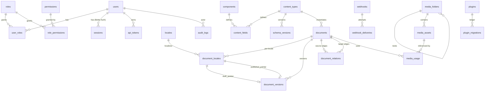

# Peggy CMS — Database Model Design
**Document:** `docs/03-database-model.md`
**Version:** 0.2.0 — OQ-01…OQ-06 resolved, spike complete
**Spike report:** `docs/00-better-auth-spike.md`
**Companion docs:** `01-product-requirements.md`, `02-technical-architecture.md`
**ORM:** Drizzle ORM · **DB:** PostgreSQL 16 (local Docker for dev, Neon for preview/prod)

---

## 1. Database Architecture

One logical Postgres database per Peggy deploy (D2: single-project-per-deploy). Two schema groups:

- **System metadata (relational, migrated):** users, roles, permissions, sessions, content_types, content_fields, components, locales, media, api_tokens, plugins, webhooks, audit, outbox. Fully relational with FKs, uniques, check constraints. Managed by Drizzle migrations, versioned, reversible.
- **Content payloads (semi-structured, data rows):** `documents` (identity) + `document_locales` (per-locale pointers) + `document_versions` (immutable `data JSONB`) + `document_relations` (edges). No per-content-type DDL in MVP (D1). Queryability via GIN on `data` + extracted columns + btree/partial indexes.

```
system tables (Drizzle schema, migrations) ──▶ strong consistency, RBAC, registry
document_* tables ──▶ identity + locale pointers + JSONB versions + relation edges
media binaries ──▶ Cloudinary (only metadata in PG)
async intent ──▶ outbox + webhook_deliveries (pollable by future worker)
```

Connection: `DbClient` port with `NeonHttpAdapter` (serverless, fetch-based, no sockets) and `PgPoolAdapter` (long-lived dev/worker). No in-request DDL. Every content write is one transaction: `documents + document_locales + document_versions + document_relations + audit_logs + outbox`.

## 2. Database Design Principles

DB-01 Metadata vs content separation: schema definitions are rows, never tables. Content payloads are JSONB versions, never columns-per-field.
DB-02 No polymorphic FKs (no `reference_id + reference_type`); every association is an explicit edge table or nullable FK.
DB-03 JSONB only for schemaless content (`document_versions.data`), conditions blobs, settings, webhook payloads. Never for FKs, money, uniques, or anything needing referential integrity — those are extracted columns.
DB-04 Immutability for history: versions and audit rows are insert-only (no UPDATE/DELETE except retention purge by operator role).
DB-05 Pointers, not flags, for publish: `document_locales.published_version_id` nullable FK; leak prevention is `IS NOT NULL` predicate, not a boolean that can be forgotten.
DB-06 Per-locale identity (D3/D4): locale is part of the localization row PK, publish is per locale, uniques default per-locale.
DB-07 Deny-by-default RBAC in data: absence of `role_permissions` row = deny; unknown `conditions` = deny.
DB-08 UUIDv7 PKs for all distributed-write tables (time-ordered, index-friendly); `document_id` stable public identifier (UUIDv7, exposed in API as `documentId`).
DB-09 Timestamps `timestamptz` UTC everywhere; `created_at` immutable, `updated_at` trigger-maintained on mutable tables only.
DB-10 Soft-delete only where history matters (media, documents via retained versions); hard-delete for sessions/tokens revocation lists with audit tombstone.

## 3. Entity Overview

| # | Table | Group | Purpose |
|---|-------|-------|---------|
| 1 | `users` | authN | Human admins/editors (Better Auth–managed, isolated) |
| 2 | `roles` | authZ | Named permission bundles |
| 3 | `permissions` | authZ | `resource.action` catalog (+ conditions schema) |
| 4 | `user_roles` | authZ | User↔role assignments |
| 5 | `role_permissions` | authZ | Role↔permission grants (+ owner-only flag) |
| 6 | `sessions` | authN | DB-backed sessions (serverless-safe) |
| 7 | `api_tokens` | api access | Prefix+hash programmatic credentials + scopes |
| 8 | `locales` | i18n | BCP47 locales, default, fallback chains |
| 9 | `content_types` | registry | Collection/single/component definitions |
| 10 | `content_fields` | registry | Field definitions per type/component |
| 11 | `components` | registry | Reusable component definitions |
| 12 | `schema_versions` | registry | Immutable version snapshots + breaking-change flags |
| 13 | `documents` | content | Logical document identity per content type |
| 14 | `document_locales` | content | Per-locale draft/published pointers + timestamps |
| 15 | `document_versions` | content | Immutable version rows with `data JSONB` |
| 16 | `document_relations` | content | Relation edges between documents |
| 17 | `media_folders` | media | Hierarchical folders |
| 18 | `media_assets` | media | Provider-agnostic file metadata |
| 19 | `media_usage` | media | Asset↔document reference ledger (for 409 guards) |
| 20 | `plugins` | plugins | Installed plugin registry + state |
| 21 | `plugin_migrations` | plugins | Per-plugin migration ledger |
| 22 | `webhooks` | webhooks | Subscriptions + secrets + retry policy |
| 23 | `webhook_deliveries` | webhooks | Per-attempt delivery log (idempotency key = eventId) |
| 24 | `outbox` | events | Transactional event intent (future worker polls) |
| 25 | `audit_logs` | observability | Append-only actor/action/resource ledger |

Plugin-owned content tables (`plugin_<name>_*`) follow the same conventions and are registered in `plugins` + `plugin_migrations`; not enumerated here.

## 4. Entity Relationship Diagram



Core invariant visible in the diagram: `documents` never hold content; `document_versions` hold content immutably; `document_locales` hold the only mutable publish pointers. Deleting content never deletes history (versions retained).

## 5. Users

```
TABLE: users
Purpose: Human identities. Managed through AuthPort (Better Auth adapter in MVP).
  Domain never queries password hashes; auth adapter owns credential verification.
Columns:
  id UUIDv7 PK
  email CITEXT UNIQUE NOT NULL (case-insensitive; citext extension)
  email_verified_at TIMESTAMPTZ NULL
  display_name TEXT NOT NULL
  avatar_asset_id UUID FK → media_assets.id NULL (SET NULL on delete)
  is_active BOOLEAN NOT NULL DEFAULT true (deactivate ≠ delete)
  is_super_admin BOOLEAN NOT NULL DEFAULT false (seed-only; bypasses RBAC checks, audited when used)
  created_at / updated_at TIMESTAMPTZ
  %% Spike OQ-01 complete: this table IS the Better Auth `user` table, generated by
  %% `npx @better-auth/cli generate --adapter drizzle` (adapter `@better-auth/drizzle-adapter`,
  %% `provider: "pg"`), extended via `additionalFields` (displayName, avatarAssetId, isActive,
  %% isSuperAdmin). Password hashing: Better Auth scrypt default (Argon2id custom hash/verify
  %% reserved post-MVP). Credentials live in the generated `account` table; reset/OTP in
  %% `verification`. Residual C-02 (option shapes for pinned version) gates kickoff. %%
Relationships: → user_roles (1:N), → sessions (1:N), → api_tokens.created_by (1:N), → audit_logs.actor (1:N)
Indexes: UNIQUE(email); INDEX(is_active) WHERE is_active (partial, admin list)
Constraints: CHECK(email ~ '^[^@]+@[^@]+\.[^@]+$') (defense in depth; Zod is primary)
Lifecycle: created on invite/register → verified → active; never hard-deleted if audit rows reference (deactivate instead)
Reasoning: users carry no permissions directly (always via roles) so permission audits are role-scoped; super-admin is a break-glass flag, not a role, to keep role matrix testable.
```

## 6. Roles

```
TABLE: roles
Purpose: Named bundles; the only unit admins assign to users.
Columns: id UUIDv7 PK · code TEXT UNIQUE NOT NULL (e.g. 'editor','author') · name TEXT NOT NULL ·
  description TEXT · is_system BOOLEAN NOT NULL DEFAULT false (seed roles protected from delete) ·
  created_at/updated_at
Relationships: ↔ users via user_roles; ↔ permissions via role_permissions
Indexes: UNIQUE(code); INDEX(is_system)
Constraints: system roles cannot be deleted (trigger) or renamed code (check in service + DB trigger)
Lifecycle: seeded (super_admin*, editor, author, viewer) → admin-created → assigned; *super_admin role unused if flag used — pick one pattern in spike and drop the other
Reasoning: code (stable, API-facing) vs name (display) split lets admin rename labels without breaking scopes/token checks.
```

## 7. Permissions

```
TABLE: permissions
Purpose: Catalog of grantable actions. Seeded per content type + system capabilities.
Columns: id UUIDv7 PK · resource TEXT NOT NULL (e.g. 'post','media','content-types') ·
  action TEXT NOT NULL (e.g. 'create','read','update','delete','publish','unpublish','manage') ·
  description TEXT · conditions_schema JSONB NOT NULL DEFAULT '{}' (declares allowed condition keys; MVP: {} or {"owner": true}) ·
  created_at
Relationships: ↔ roles via role_permissions
Indexes: UNIQUE(resource, action)
Constraints: CHECK(action IN (...)) enumerated; resource validated against registry/system list at seed + plugin install
Lifecycle: seeded on boot/migrate; extended when content type created (6 rows) or plugin installed (manifest-declared)
Reasoning: permissions as data (not code enums) lets Builder-created types gain RBAC without deploy; conditions_schema makes future policy engine additive.
```

Join tables:

```
TABLE: user_roles — user_id FK→users (CASCADE) · role_id FK→roles (CASCADE) · granted_by FK→users NULL ·
  granted_at · PK(user_id, role_id) · INDEX(role_id)
TABLE: role_permissions — role_id FK→roles (CASCADE) · permission_id FK→permissions (CASCADE) ·
  conditions JSONB NULL (MVP: NULL or {"owner": true}; anything else → deny + CONDITION_NOT_SUPPORTED) ·
  granted_by · granted_at · PK(role_id, permission_id) · GIN(conditions) for future policy queries
Reasoning: conditions live on the grant (role×permission), not on the permission — same action can be owner-scoped for Authors and global for Editors.
```

## 8. Sessions

```
TABLE: sessions
Purpose: DB-backed sessions so serverless instances share state (no memory store).
Columns: id TEXT PK (Better Auth–issued opaque; spike-verified) · token TEXT UNIQUE NOT NULL (session token) · user_id FK→users CASCADE NOT NULL ·
  expires_at TIMESTAMPTZ NOT NULL · ip INET NULL · user_agent TEXT NULL · created_at · last_seen_at ·
  revoked_at NULL (explicit logout/all-sessions revoke)
Indexes: INDEX(user_id, expires_at); INDEX(expires_at) for sweeper; partial INDEX WHERE revoked_at IS NULL
Constraints: CHECK(expires_at > created_at)
Lifecycle: create on sign-in → touch last_seen (async, non-blocking) → expire (sweeper deletes) or revoke (sets revoked_at, audited)
Lifetimes (spike-verified): `expiresIn` 7 days, `updateAge` 24h rolling refresh, 5-min JWE `cookieCache` (hot reads skip DB on Lambda). Mount: `toNodeHandler(auth)` at `/api/auth/*` before `express.json()`. Neon-HTTP adapter interop is C-01 (fallback: pooled `pg` for auth routes, no domain change).
Reasoning: DB sessions trade a read per request for serverless correctness; hot path mitigated by JWE cookie cache + async `last_seen` touches.
```

## 9. Content Types

```
TABLE: content_types
Purpose: Registry entry per collection/single/component-hosting type. Source of truth for routes, validation, admin.
Columns: id UUIDv7 PK · name TEXT UNIQUE NOT NULL (e.g. 'post') · kind TEXT NOT NULL (collection|single|component-host?) ·
  %% components live in components table; kind here is collection|single %%
  collection_slug TEXT UNIQUE NOT NULL (e.g. 'posts' → /api/v1/posts) · display_name TEXT ·
  description TEXT · is_localized BOOLEAN DEFAULT false · has_draft_publish BOOLEAN DEFAULT true ·
  active_schema_version INT NOT NULL DEFAULT 1 · created_by FK→users NULL · created_at/updated_at
Indexes: UNIQUE(name); UNIQUE(collection_slug); INDEX(kind)
Constraints: CHECK(kind IN ('collection','single')); CHECK(collection_slug ~ '^[a-z0-9-]+$')
Lifecycle: created → versioned mutations (each bumps active_schema_version + schema_versions row) → soft-blocked delete if documents exist (409 unless force)
Reasoning: slug decoupled from name so API paths stay stable while display names change; version pointer enables lenient reads of old documents.
```

## 10. Fields

```
TABLE: content_fields
Purpose: Field definitions. Rows, not columns (D1).
Columns: id UUIDv7 PK · owner_kind TEXT NOT NULL ('content_type'|'component') · owner_id UUID NOT NULL (no polymorphic FK —
  enforced by two nullable FKs: content_type_id FK NULL, component_id FK NULL, exactly-one CHECK) ·
  name TEXT NOT NULL (e.g. 'slug') · label TEXT · field_type TEXT NOT NULL
  (text|richtext|markdown|number|boolean|date|datetime|time|json|email|uid|enumeration|media|relation|component|dynamiczone) ·
  required BOOLEAN DEFAULT false · unique_scope TEXT NULL (null|per_locale|global) · default_value JSONB NULL ·
  localized BOOLEAN DEFAULT false · searchable BOOLEAN DEFAULT false · indexed_hint BOOLEAN DEFAULT false ·
  validation JSONB NOT NULL DEFAULT '{}' (min/max/pattern/enum values/message override) ·
  relation_config JSONB NULL (targetType, kind, inverse, onDelete) · component_config JSONB NULL (componentId, repeatable) ·
  dynamiczone_config JSONB NULL (allowedComponents[]) · media_config JSONB NULL (multiple, allowedMimes) ·
  sort_order INT NOT NULL · created_at/updated_at
Indexes: INDEX(content_type_id) WHERE content_type_id IS NOT NULL; INDEX(component_id) WHERE ...; UNIQUE(content_type_id, name); UNIQUE(component_id, name)
Constraints: CHECK((content_type_id IS NULL) <> (component_id IS NULL)) (exactly one owner — avoids polymorphic FK);
  CHECK(localized = false OR owner type is_localized) (enforced in service; DB check via trigger on join — documented);
  reserved-name block enforced in service (id, documentId, __component, createdAt...) + DB CHECK against list
Lifecycle: added → configured → (breaking-change flagged) → deprecated (hidden from new docs, readable on old) — never silently dropped
Reasoning: exactly-one-owner CHECK gives relation-less polymorphism safety; *_config JSONB columns keep field-type-specific knobs schemaless without EAV explosion; extracted queryables (slug etc.) live in document_versions extracted columns, not here.
```

## 11. Components

```
TABLE: components
Purpose: Reusable embedded structures (SEO, Hero). No identity, no routes, no publish lifecycle.
Columns: id UUIDv7 PK · name TEXT UNIQUE NOT NULL (e.g. 'seo') · display_name TEXT · category TEXT (e.g. 'layout','seo') ·
  active_schema_version INT DEFAULT 1 · created_at/updated_at
Relationships: → content_fields (owner_kind='component'); referenced by content_fields.component_config / dynamiczone_config (by id, validated in service)
Indexes: UNIQUE(name)
Lifecycle: versioned like types; deleting a component used by types → 409 COMPONENT_IN_USE (list usages)
Reasoning: components versioned independently so Hero v2 doesn't force Post v5; documents snapshot component data inline in versions.data (composition, not reference).
```

## 12. Dynamic Zones

Dynamic zones are not a table. They are a field (`field_type='dynamiczone'`) whose `dynamiczone_config.allowedComponents[]` lists component IDs and whose runtime value in `document_versions.data` is an ordered array `[{ __component: 'hero', id: <client-uuid>, data: {...} }]`. Order is array order; block `id` is client-generated (stable for reorder/audit diff). Validation: each block validated against its component's Zod schema at active version; unknown `__component` → 422. Reasoning: a zone table would add join churn per block reorder; inline ordered JSON with per-block validation gives O(1) reorder and matches composition semantics.

## 13. Documents

```
TABLE: documents
Purpose: Stable logical identity. Holds no content, no locale, no status — only (type + stable id + provenance).
Columns: id UUIDv7 PK (internal) · document_id UUIDv7 UNIQUE NOT NULL (public, stable across locales/versions; exposed as documentId) ·
  content_type_id FK→content_types.id RESTRICT NOT NULL (type retarget forbidden; create-new instead) ·
  created_by FK→users SET NULL · created_at · deleted_at NULL (tombstone; history retained)
Relationships: → document_locales (1:N per locale) → document_versions (1:N) → document_relations (edges)
Indexes: UNIQUE(document_id); INDEX(content_type_id, created_at DESC) (type-scoped lists); partial INDEX WHERE deleted_at IS NULL
Constraints: content type immutable (trigger rejects UPDATE of content_type_id)
Lifecycle: create (with first locale) → localizations added → versions accumulate → tombstoned on delete (locales/versions retained for restore/audit)
Reasoning: separating identity from localization/versioning is what makes per-locale publish, fallback, and restore trivial and leak-safe; documentId stability lets relations survive locale/version churn.
```

## 14. Document Versions

```
TABLE: document_locales  (localization + publish pointers)
Purpose: Per-(document, locale) state. The ONLY mutable publish state in the system.
Columns: document_id FK→documents.id CASCADE · locale TEXT FK→locales.code RESTRICT NOT NULL ·
  draft_version_id FK→document_versions.id NULL (exactly-one-draft invariant) ·
  published_version_id FK→document_versions.id NULL (null = unpublished) ·
  published_at NULL · first_published_at NULL · scheduled_at NULL (reserved post-MVP worker) ·
  scheduled_version_id FK NULL · updated_at · PK(document_id, locale)
Indexes: PK; INDEX(locale, published_version_id) WHERE published_version_id IS NOT NULL (public surface);
  INDEX(scheduled_at) WHERE scheduled_at IS NOT NULL (future worker poll)
Constraints: FKs DEFERRABLE for publish txn; CHECK(draft_version_id <> published_version_id OR either null — same version publish is idempotent no-op in service, not DB error)
Lifecycle: created with draft pointer → publish sets published pointer → unpublish clears → delete tombstones parent (rows retained)
Reasoning: pointers make publish O(1) metadata flip (no data copy), unpublish non-destructive, and public queries a single IS NOT NULL predicate.

TABLE: document_versions (immutable content)
Purpose: Every save creates a row. Publish moves pointers, never data. History + restore + audit diff source.
Columns: id UUIDv7 PK · document_id FK→documents CASCADE NOT NULL · locale TEXT NOT NULL (denormalized for partition/query; matches parent) ·
  version INT NOT NULL (per-(document, locale) sequence) · status TEXT NOT NULL ('draft'|'published-snapshot'|reserved) ·
  data JSONB NOT NULL (validated content payload) · schema_version INT NOT NULL (registry version at write) ·
  slug TEXT NULL (extracted: uid field, normalized; null when type has no slug) ·
  published_at_snapshot NULL · created_by FK→users SET NULL · created_at (immutable; no updated_at — immutable rows need none)
Relationships: referenced by document_locales pointers; UNIQUE(document_id, locale, version)
Indexes: UNIQUE(document_id, locale, version); GIN(data) with jsonb_path_ops (search/filter);
  INDEX(content_type via join — see §24 for extracted content_type denormalization decision);
  partial UNIQUE(content_type_id, locale, slug) WHERE slug IS NOT NULL (per-locale unique, D3);
  separate partial UNIQUE(content_type_id, slug) WHERE unique_global flag (global slugs);
  BRIN(created_at) for history scans; INDEX(document_id, locale, created_at DESC) (version history)
Constraints: CHECK(status IN ('draft','published','in_review','scheduled','archived')) (future states accepted, service gates transitions);
  CHECK(jsonb_typeof(data) = 'object'); IMMUTABLE: trigger rejects UPDATE/DELETE (purge only via operator retention job)
Lifecycle: insert-only → pointed-to by draft/published → retained after unpublish/delete (restore/audit)
Reasoning: immutability gives free revision history, safe publish (pointer flip can't corrupt data), and idempotent retries (re-POST same version = no-op); extracted slug column enforces uniques without JSONB unique-index hacks; content_type denormalized (see §24) to avoid join for the hottest list queries.
```

## 15. Locales

```
TABLE: locales
Purpose: Locale registry + fallback policy.
Columns: code TEXT PK (BCP47, e.g. 'en','fr','en-GB') · name TEXT NOT NULL · is_default BOOLEAN NOT NULL DEFAULT false ·
  is_active BOOLEAN DEFAULT true · direction TEXT DEFAULT 'ltr' (ltr|rtl) · fallback_chain TEXT[] NOT NULL DEFAULT '{}' (ordered codes) ·
  created_at/updated_at
Indexes: partial UNIQUE WHERE is_default (exactly one default); INDEX(is_active)
Constraints: CHECK(code ~ '^[a-z]{2}(-[A-Z]{2})?$'); CHECK(direction IN ('ltr','rtl')); trigger: exactly-one default; trigger: fallback_chain members must exist+active; default locale cannot be deactivated/deleted while documents reference
Lifecycle: seeded (en default + fr per PRD seed) → added/deactivated. DEFAULT IMMUTABLE AFTER SEED (OQ-06): flipping `is_default` with existing content is forbidden by trigger when `document_locales` rows exist; change requires explicit migration (new default seed + per-document locale backfill + `fallback_chain` rewrite + re-validation of per-locale uniques), reviewed and audited — never a flag flip
Reasoning: fallback_chain as array keeps read-time fallback O(chain) without graph table; exactly-one-default as partial unique is race-safe under concurrent admin edits.
```

## 16. Media

```
TABLE: media_folders
Purpose: Hierarchical organization.
Columns: id UUIDv7 PK · name TEXT NOT NULL · parent_id FK→media_folders.id CASCADE NULL · path TEXT NOT NULL (materialized '/landing/hero', maintained by trigger) ·
  created_by · created_at/updated_at
Indexes: UNIQUE(parent_id, name) (NULL-safe via COALESCE — use UNIQUE(path) as well); INDEX(path text_pattern_ops); recursive CTE for descendants
Constraints: CHECK(id <> parent_id) (no self-parent); trigger prevents cycles (ancestor check)
Lifecycle: create → rename/move (path cascade) → delete (blocked if assets inside unless recursive+force)

TABLE: media_assets
Purpose: Provider-agnostic metadata. One row per file. Binaries in Cloudinary.
Columns: id UUIDv7 PK · provider TEXT NOT NULL DEFAULT 'cloudinary' · provider_key TEXT NOT NULL (public_id) ·
  url TEXT NOT NULL · secure_url TEXT NOT NULL · mime TEXT NOT NULL · size_bytes INT NOT NULL ·
  width INT NULL · height INT NULL · duration_s NUMERIC NULL · hash_sha256 TEXT NULL (dedupe/integrity) ·
  folder_id FK→media_folders SET NULL · alt TEXT · caption TEXT · variants JSONB DEFAULT '[]' (named transform presets used) ·
  uploaded_by FK→users SET NULL · deleted_at NULL (soft-delete; provider destroy async) · created_at/updated_at
Indexes: UNIQUE(provider, provider_key); INDEX(folder_id); INDEX(mime text_pattern_ops); INDEX(hash_sha256) (dedupe lookup); partial INDEX WHERE deleted_at IS NULL
Constraints: CHECK(size_bytes > 0 AND size_bytes <= 104857600); CHECK(mime ~ '^.+/.+$'); SVG blocked in service (config-overridable), recorded here as policy not schema
Lifecycle: signed → confirmed (HEAD cross-check) → attached (media_usage row) → replaced (new row, refs moved per policy) → soft-deleted (provider destroy queued) → purged

TABLE: media_usage
Purpose: Reference ledger enabling 409 MEDIA_REFERENCED guards + reverse lookup ("where is this image used?").
Columns: asset_id FK→media_assets CASCADE · document_id FK→documents CASCADE · locale TEXT NOT NULL · field_path TEXT NOT NULL (e.g. 'cover' or 'sections[2].image') ·
  version_id FK→document_versions NULL · PK(asset_id, document_id, locale, field_path)
Indexes: PK; INDEX(document_id, locale) (per-doc usage); INDEX(asset_id) (referenced-by)
Reasoning: ledger (not JSON scan) makes delete-guards O(1) and survives data-shape changes; field_path records where, version_id records when.
```

## 17. Media Folders

Covered in §16 (same tables). Folder depth limit 8 (service constant, prevents path blowup); folder move is a single `path` prefix update in transaction + audit.

## 18. API Tokens

```
TABLE: api_tokens
Purpose: Programmatic credentials, independent of Better Auth sessions.
Columns: id UUIDv7 PK · name TEXT NOT NULL · prefix TEXT UNIQUE NOT NULL (e.g. 'peggy_abc123' — indexed lookup key, shown in UI) ·
  secret_hash TEXT NOT NULL (SHA-256(secret+pepper) or bcrypt — spike-confirmed minimum; never reversible) ·
  scopes TEXT[] NOT NULL (permission strings, e.g. '{post.read,media.read}') · expires_at NULL ·
  last_used_at NULL (async touch) · revoked_at NULL · created_by FK→users · created_at
Indexes: UNIQUE(prefix); INDEX(expires_at); partial INDEX WHERE revoked_at IS NULL
Constraints: CHECK(array_length(scopes,1) > 0); CHECK(expires_at IS NULL OR expires_at > created_at)
Lifecycle: create (secret shown once) → used (scope check + published-ceiling + expiry/revoke check) → rotated (new row, old revoked with overlap note) → revoked/expired (401 with distinct codes)
Reasoning: prefix+hash (not encrypted secret) means DB breach doesn't yield tokens; scopes reuse permission strings so token auth and session auth share evaluation code; published-ceiling enforced in Query Engine regardless of scopes.
```

## 19. Plugins

```
TABLE: plugins
Purpose: Installed-plugin registry + runtime state (degraded-mode support).
Columns: name TEXT PK (e.g. 'seo-audit') · version TEXT NOT NULL (semver) · peer_peggy TEXT NOT NULL (compatible core range) ·
  manifest JSONB NOT NULL (routes, permissions, slots, events, tables) · state TEXT NOT NULL DEFAULT 'disabled'
  (discovered|registered|bootstrapped|disabled|failed) · config JSONB NOT NULL DEFAULT '{}' (admin-editable settings, validated by plugin schema) ·
  installed_by · installed_at · updated_at
Indexes: INDEX(state)
Constraints: CHECK(state IN (...)); CHECK(manifest ? 'name' AND manifest ? 'version')
Lifecycle: discovered → registered (dep check) → bootstrapped (migrations from plugin_migrations + routes mounted) → disabled/failed (core keeps booting)

TABLE: plugin_migrations
Purpose: Per-plugin migration ledger (core migrations never touch plugin tables and vice versa).
Columns: plugin_name FK→plugins.name CASCADE · version TEXT NOT NULL · applied_at · PK(plugin_name, version)
Physical plugin tables: plugin_<name>_* — created by plugin migrations, namespaced, dropped on uninstall (with ?purgeData confirm + audit)
Reasoning: namespacing + ledger lets plugins evolve storage without core coupling and uninstall cleanly; manifest-as-data lets admin UI render plugin settings without importing plugin code.
```

## 20. Webhooks

```
TABLE: webhooks
Purpose: Event subscriptions.
Columns: id UUIDv7 PK · name TEXT NOT NULL · url TEXT NOT NULL · events TEXT[] NOT NULL (e.g. '{document.published}') ·
  secret TEXT NOT NULL (HMAC key, encrypted at rest — pgcrypto or KMS %%impl detail%%) · is_active BOOLEAN DEFAULT true ·
  timeout_ms INT DEFAULT 10000 · max_attempts INT DEFAULT 3 · created_by · created_at/updated_at
Indexes: INDEX(is_active); GIN(events)
Constraints: CHECK(url ~ '^https://'); CHECK(array_length(events,1) > 0); CHECK(timeout_ms BETWEEN 1000 AND 30000);
  SSRF: service validates (no localhost/169.254.0.0/16/private ranges in prod — validation, not schema)
Lifecycle: create (secret generated, shown once) → test-ping → active → paused/failed-circuit → deleted (deliveries retained 30d for forensics)
```

## 21. Webhook Deliveries

```
TABLE: webhook_deliveries
Purpose: Per-attempt log + idempotency + retry scheduling.
Columns: id UUIDv7 PK · webhook_id FK→webhooks.id SET NULL (retain log after subscription delete) ·
  event_id UUID NOT NULL (idempotency key = outbox eventId; receiver dedupes) · event_type TEXT NOT NULL ·
  payload JSONB NOT NULL · attempt INT NOT NULL DEFAULT 1 · status TEXT NOT NULL (pending|success|failed|exhausted) ·
  http_status INT NULL · latency_ms INT NULL · error TEXT NULL · next_retry_at NULL · delivered_at NULL · created_at
Indexes: UNIQUE(webhook_id, event_id, attempt); INDEX(webhook_id, created_at DESC); INDEX(next_retry_at) WHERE status='pending' (worker poll); INDEX(event_id) (idempotency lookup)
Constraints: CHECK(attempt >= 1 AND attempt <= max configured); exponential backoff computed in service (base 30s × 2^attempt)
Lifecycle: enqueued (from outbox dispatch) → success (2xx) → done; else retry until max_attempts → exhausted (flag + optional admin alert) → manual replay creates new attempt row (same event_id)
Reasoning: (webhook, event, attempt) uniqueness makes at-least-once safe; next_retry_at partial index keeps future worker poll O(pending) not O(history).
```

## 22. Audit Logs

```
TABLE: audit_logs
Purpose: Append-only security/compliance ledger. Answers "who published what, when, from where".
Columns: id UUIDv7 PK · actor_id FK→users SET NULL (null = system/token) · actor_type TEXT (user|api_token|system) ·
  token_prefix TEXT NULL (which token, without secret) · action TEXT NOT NULL (e.g. 'document.publish','role.grant','token.revoke') ·
  resource TEXT NOT NULL · resource_id TEXT NULL · locale TEXT NULL · diff JSONB NULL (before/after for content; redacted for secrets) ·
  ip INET NULL · user_agent TEXT NULL · request_id TEXT NOT NULL · created_at (no updated_at — immutable)
Indexes: INDEX(resource, resource_id, created_at DESC) (per-object history); INDEX(actor_id, created_at DESC);
  INDEX(action, created_at DESC); INDEX(request_id) (trace join); BRIN(created_at) (retention scans)
Constraints: trigger rejects UPDATE/DELETE (purge only via operator retention job with its own audit row); CHECK(action ~ '^[a-z0-9.]+$')
Lifecycle: insert-only → retained 12 months (OQ-04; `AUDIT_RETENTION_MONTHS=12` config, changeable without schema redesign — retention job reads config, tables unchanged) → range-purged by operator job (purge itself audited)
Redaction at write (OQ-04): service strips secrets, auth credentials, access tokens, passwords, and unnecessary PII from `diff`/payload before insert; redaction allowlist per action, tested in CI (fixture asserts no `password|secret|token` keys in stored rows)
Reasoning: immutability trigger (not just convention) survives compromised-app scenarios where attacker holds DB creds but not superuser; request_id joins audit to request logs.
```

Also: `TABLE: outbox` — `event_id UUID PK · type TEXT · payload JSONB · actor_id NULL · document_id NULL · locale NULL · created_at · dispatched_at NULL · INDEX(dispatched_at) WHERE dispatched_at IS NULL`. Written in same txn as business rows; dispatcher marks dispatched. Payloads never contain secrets.

## 23. Relationships (consolidated rules)

- Restrict: `documents.content_type_id`, `document_locales.locale`, `content_fields` owners (no orphan fields).
- Cascade: `user_roles/role_permissions/sessions` on user/role delete (with audit tombstone); `document_locales/versions/relations/media_usage` on document delete (history retained under tombstone — cascade sets pointers, purge is separate retention job).
- Set-null: `media_assets.folder_id`, `documents.created_by`, `media_assets.uploaded_by`, `audit_logs.actor_id` (attribution survives target deletion).
- Exactly-one invariants: one default locale (partial unique); one draft pointer per (doc, locale) (column, not row — structural); one active content-type slug (unique).
- No polymorphic FKs anywhere; plugin tables reference core only via `document_id`/UUID (no cross-schema FKs — plugin uninstall must not cascade core data).

## 24. Indexing Strategy

| Access pattern | Index | Type |
|---|---|---|
| Public list: type+locale+published+sort | `(content_type_denorm, locale, published_version_id, published_at DESC)` composite on `document_locales JOIN documents` — implemented as covering index on materialized helper view or denormalized `content_type_id` on `document_locales` (recommended: denormalize `content_type_id` onto `document_locales` + `document_versions` at write; storage cost negligible, avoids join on hottest path) | btree composite + partial `WHERE published_version_id IS NOT NULL` |
| Slug lookup (unique enforcement + GET by slug) | partial `UNIQUE(content_type_id, locale, slug) WHERE slug IS NOT NULL` + global variant | btree unique partial |
| Full-text search `?q=` | `GIN(to_tsvector('english', data->>'title' \|\| ' ' \|\| ...))` — generated `search_vector tsvector` column maintained by trigger over `searchable:true` fields only | GIN |
| JSONB filter `filters[field][$eq]` on extracted fields | btree on extracted columns (`slug`, plus per-type `indexed_hint` numerics/dates — capped 5 per type, service-managed) | btree |
| Arbitrary JSONB containment | `GIN(data jsonb_path_ops)` | GIN |
| Version history | `(document_id, locale, created_at DESC)` | btree |
| Relation traversal (populate + restrict-check) | `(source_document_id)`, `(target_document_id)`, composite `(source_document_id, relation_name)` | btree |
| Admin drafts-all | `(content_type_id, locale, updated_at DESC)` on `document_locales` (no published predicate) | btree |
| Audit per-object | `(resource, resource_id, created_at DESC)` | btree |
| Webhook worker poll | `(next_retry_at) WHERE status='pending'` | btree partial |
| Token lookup | `(prefix) WHERE revoked_at IS NULL` | btree unique partial |

Index budget: ~25 indexes total MVP; `pg_stat_user_indexes` review each release; `EXPLAIN` CI gate on seed dataset (list + populate + search) fails on Seq Scan over >10k rows.

## 25. Constraints (defense in depth)

Zod validates first; DB constrains second. Enumerated CHECKs on: `kind, field_type, unique_scope, status, direction, action, state, actor_type`. Uniques: emails, slugs (scoped), role codes, permission pairs, token prefixes, `(document, locale, version)`, `(webhook, event, attempt)`. Exclusions: none in MVP (documented future: `EXCLUDE` on scheduled-publish windows if overlapping schedules become a requirement). Triggers: `updated_at` maintenance (mutable tables), `search_vector` + `path` maintenance, immutability guards (versions, audit), exactly-one-default-locale, no-self-parent folders, content-type immutability on documents.

## 26. Transactions

Service owns boundaries (`BEGIN; ... COMMIT`), repositories take `tx`. Standard write txn: lock `document_locales` row (`SELECT FOR UPDATE`) → insert `document_version` → update pointers → upsert `document_relations` + `media_usage` → insert `audit_logs` + `outbox` → commit. Publish adds schema-revalidation inside txn (draft still conforms to active version; else 422 + no pointer move). Isolation `READ COMMITTED` default; `REPEATABLE READ` for bulk publish (snapshot across items); lock timeout 5s + statement timeout 15s (fail fast, never hang serverless). Outbox pattern means events commit atomically with data — no "saved but no event" or vice versa. Idempotency: client-supplied `Idempotency-Key` header → `idempotency_keys` table (key, route-hash, response, expires 24h) checked first in txn.

## 27. Migration Strategy

- System tables: Drizzle `drizzle-kit generate/migrate`, checked-in SQL, up+down, CI runs on ephemeral PG, prod applies at deploy (blocking, before handler warmup). Content schema changes are **data**, never migrations — no DDL per Builder edit, ever.
- Content-type evolution without DDL: new fields are nullable-by-default at read (lenient reads, `meta.schemaStale`); backfills are batched service jobs (not migrations) writing new versions, never UPDATE-in-place.
- Plugin tables: `plugin_migrations` ledger, `peggy migrate --plugin=<name>`; core `migrate` ignores plugin schemas. Uninstall: `DROP TABLE plugin_<name>_*` only with `?purgeData=true` + audit.
- Breaking operations (global-unique added, type narrowed): service requires `confirmBreaking` + writes `schema_versions.breaking_notes`; optional async backfill validates existing docs and reports violations (does not block).

## 28. PostgreSQL-Specific Considerations

Version 16. Extensions: `citext` (emails), `pg_trgm` (fuzzy search fallback), `pgcrypto` (token/secret hashing if not app-side), `uuid-ossp` unnecessary (app-generated UUIDv7). `timestamptz` + UTC everywhere; `INET` for IPs; `TEXT[]` for scopes/events/chains with GIN where filtered. JSONB operators used: `@>`, `?`, `jsonb_path_query` (filters compile to these; never string-interpolated). `CITEXT` vs `LOWER()`: citext chosen for emails (unique index correctness). Collation: `C.UTF-8` for slug/identifier columns (byte-order, index-stable), locale-aware collation only for display sorting (documented). Partitioning: `document_versions` range-partition by `created_at` prepared (script included, not activated until >1M rows). RLS: not in MVP (app-level AuthZ), but tables structured RLS-ready (actor columns present) for post-MVP defense-in-depth. `audit_logs` time-range purge uses BRIN on `created_at`; range-partitioning pre-approved if retention growth demands it (no API change). Autovacuum tuned for high-churn `document_versions`/`webhook_deliveries`; `pg_stat_statements` enabled in all envs for slow-query review.

## 29. Drizzle ORM Mapping

Static system tables → checked-in Drizzle schemas (`packages/database/schema/*.ts`) with inferred TS types (`typeof users.$inferSelect`) re-exported via `@peggy/shared`. Dynamic content → **no per-type Drizzle tables**; instead typed repository layer:

```ts
// documentVersionRepo: Drizzle over the fixed document_* tables + JSONB helpers
db.insert(documentVersions).values({ documentId, locale, version, status, data: sql`${validated}::jsonb`, slug, schemaVersion })
db.select().from(documentLocales).where(and(eq(typeId), eq(locale), isNotNull(publishedVersionId)))
```

Zod (from Registry) is the validator; Drizzle is the typed SQL emitter; `data` column typed as `ContentPayload` (generated TS per type, see arch §9). Raw SQL confined to `packages/database` (`sql`` for GIN/tsvector only), reviewed, never interpolated with user input (params only). Migration files are SQL (reviewable), schemas are TS (single definition via `drizzle-kit` introspection check in CI to prevent drift).

## 30. Database Scalability Considerations

Capacity MVP: 500 types, 500k docs, 5M versions (history), 100 rps/unit. Growth levers in order: (1) widen extracted columns (promote hot JSONB paths to btree without code change to API), (2) read-replica split via `DbClient.read` (writes stay primary; public lists go replica; replication lag surfaced as `meta.staleRead` when detected), (3) `document_versions` time-partitioning + cold-history offload, (4) materialized per-type views/tables for top-5 hot types only (measured, never speculative), (5) search offload (Trigram→OpenSearch only when `q` latency breaches NFR-001 on production data). What we will not do: sharding, multi-master, or per-tenant databases in MVP (D2 single-project). Connection math documented: serverless → Neon HTTP (no pool); containers → pool `max = (CPU×2)+spare`, statement/pool timeouts set, PgBouncer reserved for post-MVP if pool saturation measured.

---
*End of database model v0.2.0. Normative table specs are §5–§22. D1 (JSONB-first, no per-type DDL), D3/D4 (per-locale pointers), D7 (owner-only conditions column) are load-bearing — changing them reopens ADR-004/006/010/014/015. OQ-01…OQ-06 resolutions above are binding.*
