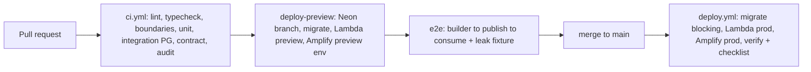

# Peggy CMS — Deployment Guide
**Document:** `docs/04-deployment-guide.md`
**Version:** 0.2.0 — Targets locked: API → AWS Lambda, Admin → AWS Amplify Hosting
**Companion docs:** `00-better-auth-spike.md`, `01-product-requirements.md`, `02-technical-architecture.md`, `03-database-model.md`
**Blueprint alignment:** v0.2.0 (OQ-01…OQ-06 resolved)
**Status:** Draft for implementation — verify commands against pinned dependency versions at kickoff

---

## 1. Deployment Decisions (Locked)

| Concern | Decision |
|---|---|
| API runtime | AWS Lambda (Node.js LTS), `serverless-http(createApp())`, behind API Gateway HTTP API |
| Admin hosting | AWS Amplify Hosting, Next.js static export (SPA, `output: 'export'`) |
| Database | Neon Postgres (prod/preview); local container Postgres (dev) |
| Media | Cloudinary SaaS, signed direct uploads |
| Webhook + scheduled-publish worker | Scheduled AWS Lambda via EventBridge `rate(1 minute)` (OQ-05) |
| CI | GitHub Actions with OIDC-to-AWS (no long-lived keys); sample workflows in `ci/` |
| Rate-limit preset | `lambda` baseline (SR-09/OQ-03) |
| Domains | `api.<parent>` (API Gateway custom domain), `admin.<parent>` (Amplify custom domain), cookies on `.<parent>` |

One deploy = one project (D2). Same API artifact runs locally (`listen()`), on Lambda (handler), and in CI integration tests — adapter selected by env, never by code fork.

## 2. Target Architecture

```
Browser (Admin users / editors)
   │  https://admin.example.com  (Amplify: static SPA, CDN + branch previews)
   │  NEXT_PUBLIC_API_URL=https://api.example.com
   ▼
API Gateway HTTP API  (api.example.com, JWT-agnostic passthrough; auth lives in handler)
   │  routes: /api/v1/* ──▶ Peggy API Lambda
   │           /api/auth/* ──▶ same Lambda (toNodeHandler(auth) mounted first)
   ▼
Peggy API Lambda  (1024MB, 29s timeout, serverless-http(createApp()))
   ├── Neon Postgres via HTTP driver (C-01 gates; fallback: pooled endpoint for auth routes)
   ├── Cloudinary (sign only; confirm via HEAD)
   └── outbox rows ──▶ EventBridge (1/min) ──▶ Worker Lambda (same image, WEBHOOK_WORKER_ENABLED=true)
                           ├── webhook deliveries (HMAC, 3 retries, manual replay on API)
                           └── due scheduled publishes (scheduled_at <= now())

Public consumers (web/mobile): same API Gateway → published-only scope, token auth.
```

Cold-start budget p95 ≤2.5s scale-from-zero (lazy plugin bootstrap, registry cache, no per-boot DDL).

## 3. Local Development (Unchanged)

```bash
git clone <peggy> && cd peggy
cp .env.example .env.development
docker compose -f docker-compose.dev.yml up -d   # pg:16, api hot-reload :3000, admin dev :3001, seed
pnpm install && pnpm nx run api:seed             # roles, locales en/fr, demo Post/Author
curl -s localhost:3000/health && curl -s localhost:3000/ready
```

`peggy doctor` validates all required vars at boot with actionable errors. Content schema changes are data rows — never DDL, never part of migrations.

## 4. Environment Variables (Canonical Reference)

All reads confined to `@peggy/config` (Zod-parsed). Amplify env vars are set per branch in the Amplify console (or `amplify.yml`BACKEND? no — console / CLI, never committed).

| Variable | Where | Example / default | Notes |
|---|---|---|---|
| `DATABASE_URL` | Lambda (all fns), CI migrate job | Neon pooled/HTTP URL | HTTP vs pool per C-01 outcome |
| `BETTER_AUTH_SECRET` | Lambda | 32+ random bytes | Rotate via overlap window |
| `BETTER_AUTH_URL` | Lambda | `https://api.example.com` | Canonical API origin |
| `ADMIN_URL` | Lambda | `https://admin.example.com` | CORS + cookie domain derivation |
| `CORS_ORIGINS` | Lambda | `https://admin.example.com` | Comma list; never `*` with credentials |
| `COOKIE_DOMAIN` | Lambda | `.example.com` | Cross-subdomain session cookie (see §7) |
| `CLOUDINARY_CLOUD_NAME` / `_API_KEY` / `_API_SECRET` | Lambda | — | Sign-only server-side; secret never leaves server |
| `RATE_LIMIT_PRESET` | Lambda | `lambda` | OQ-03: auth 5/min/IP, public 100/min/IP, publish 30/min/user |
| `AUDIT_RETENTION_MONTHS` | Lambda + worker | `12` | OQ-04; job reads config, no schema change |
| `WEBHOOK_WORKER_ENABLED` | worker `true`, API `false` | `false` | Guards dispatch loop to worker only |
| `SESSION_EXPIRES_DAYS` / `SESSION_UPDATE_AGE_H` / `COOKIE_CACHE_S` | Lambda | `7` / `24` / `300` | Spike-verified defaults |
| `NEXT_PUBLIC_API_URL` | Amplify (admin) | `https://api.example.com` | Baked at build; per-branch values (preview → preview API) |
| `NEXT_PUBLIC_DEFAULT_LOCALE` | Amplify | `en` | Display default; changing real default is a migration (OQ-06) |
| `LOG_LEVEL` | Lambda | `info` | `debug` in dev only |

## 5. API on AWS Lambda

Handler (`apps/api/src/lambda.ts` — composition root, thin):

```ts
import serverless from "serverless-http";
import { createApp } from "./app";          // Express app, zero domain imports
export const handler = serverless(createApp(), { binary: false });
```

Rules: `toNodeHandler(auth)` mounted at `/api/auth/*` BEFORE `express.json()`; CORS before auth handler; no file bytes through handler (413 + signed-flow pointer otherwise); no in-request webhook fan-out (outbox only).

Infrastructure sketch (Serverless Framework v4 — matches the spike-attested pattern; SST/CDK equivalent acceptable):

```yaml
service: peggy-api
provider:
  name: aws
  runtime: nodejs22.x
  memorySize: 1024
  timeout: 29
  environment:
    RATE_LIMIT_PRESET: lambda
    # secrets via ${ssm:...} / Secrets Manager — never plaintext
functions:
  api:
    handler: dist/lambda.handler
    events:
      - httpApi: { path: "/api/{proxy+}", method: "*" }
  worker:
    handler: dist/lambda.handler
    environment: { WEBHOOK_WORKER_ENABLED: "true" }
    events:
      - schedule: rate(1 minute)     # EventBridge; drains outbox + due scheduled publishes
customDomain:                        # api.example.com via ACM + Route53
  domainName: api.example.com
  basePath: ""
```

- Lambda stays OUTSIDE a VPC (Neon is reached over the internet) — keeps cold starts low. Revisit only if a future VPC-bound store is adopted.
- Migrations run as a CI job (`drizzle-kit migrate` against Neon), blocking, BEFORE traffic reaches the new revision — never inside handler boot.
- Provisioned concurrency is NOT budgeted in MVP; cookie cache + warm preview cover demo paths.

## 6. Admin on AWS Amplify Hosting

Admin is a static export (`output: 'export'`, no SSR data fetching). Amplify serves `apps/admin/out` as a static SPA.

`amplify.yml` (sample in `ci/amplify.yml` — copy to repo root at implementation):

```yaml
version: 1
applications:
  - appRoot: apps/admin
    frontend:
      phases:
        preBuild:
          commands:
            - corepack enable && pnpm install --frozen-lockfile
        build:
          commands:
            - pnpm nx run admin:export
      artifacts:
        baseDirectory: out
        files: ["**/*"]
      cache:
        paths: ["../../node_modules/**/*", ".next/cache/**/*"]
```

Branch model: `main` → production (`admin.example.com`); `develop` → preview (`develop.admin.example.com` or branch URL) wired to the preview API via per-branch `NEXT_PUBLIC_API_URL`; PR branch previews ON for design review (pointing at preview API + Neon PR branch). Custom domains in Amplify console (ACM managed by Amplify, Route53 alias).

SPA routing: Next export emits per-route `.html`; add an Amplify rewrite for client-side deep links (e.g. `/content/*` → `/content.html` 200, plus a 404 → `/404.html`). Exact rule set is finalized against the exported route table at implementation — the principle is: every admin route resolves without server compute.

Build-time vs runtime: `NEXT_PUBLIC_*` is baked at build — a branch pointed at the wrong API URL is a rebuild, not a config flip. The deploy checklist (§11) asserts the built banner/API-origin match before traffic.

## 7. Amplify ↔ Lambda Integration (Auth, Cookies, CORS)

This is the highest-risk seam — configure it exactly:

1. Same parent domain: API `api.example.com`, admin `admin.example.com`. Session cookie set with `Domain=.example.com; Secure; SameSite=Lax; HttpOnly`. Amplify custom domain + API Gateway custom domain (ACM certs) are prerequisites, not polish.
2. CORS on the API: allowlist = Amplify origin(s) only (`https://admin.example.com`, preview origins as explicit entries — never `*` with credentials).
3. Better Auth mount order in handler: `toNodeHandler(auth)` before `express.json()`; `BETTER_AUTH_URL=https://api.example.com`; cookie-cache JWE on (spike §5) so warm admin navigation skips session SELECTs.
4. CSRF tokens on cookie-session mutations; Bearer tokens for programmatic/public API (prefix-routed, independent of sessions).
5. Preview discipline: each preview admin branch talks ONLY to its paired preview API + Neon branch. Cross-wiring preview admin → prod API is blocked by CORS allowlist (defense in depth, not just convention).

## 8. Webhook + Scheduled-Publish Worker (OQ-05)

The `worker` Lambda (same image, `WEBHOOK_WORKER_ENABLED=true`, no public route) fires every minute via EventBridge and: (a) claims due `outbox` rows + `webhook_deliveries WHERE status='pending' AND next_retry_at <= now()`, (b) delivers signed POSTs (`X-Peggy-Signature` HMAC-SHA256, timestamp tolerance 5 min, `eventId` idempotency), (c) applies exponential backoff up to 3 attempts then marks `exhausted`, (d) executes due scheduled publishes (`scheduled_at <= now()`). Manual replay (`POST /webhooks/:id/replay`) stays on the API. Inngest is deferred unless volume/complexity justifies it. Worker lag/DLQ depth are logged with `requestId`-style run IDs and surfaced in `/ready` downstream checks.

## 9. CI Pipeline (GitHub Actions — Opened)

Workflows live in `.github/workflows/` (working samples in `ci/` — copy to repo root at implementation). AWS access via OIDC role assumption (no long-lived keys). Branch strategy: PR → `develop` (preview env) → `main` (prod).



`ci/ci.yml` (PR checks — every PR, required status checks):

- `setup`: pnpm install (frozen lockfile), Nx SHA-scoped cache (`nrwl/nx-set-shas`), Node pinned.
- `lint-typecheck-boundaries`: eslint, `tsc --noEmit`, `nx enforce-module-boundaries` + dependency-cruiser arch test (domain ↛ infra/app; controllers ↛ db).
- `unit`: domain suites (publish machine, fallback, permission eval, filter compiler) — ≥80% branch gate on those modules.
- `integration`: Postgres service container + ephemeral DB, API boot: FR matrix (FR-010…023), draft-leak gate (public token × draft-only → 0 rows, hard fail), owner-only matrix, fallback meta, signed-upload mock, webhook HMAC + retry + replay.
- `contract`: OpenAPI snapshot (`/api/v1/openapi.json` covers 100% routes) + generated TS client compiles without `any`.
- `audit`: `npm audit` high-severity = fail; secret-scan (no committed `.env`, no token-shaped strings).

`ci/deploy.yml` (preview on `develop` push / PR, prod on `main` push):

- `migrate` (blocking, pre-traffic): `drizzle-kit migrate` against target Neon (preview branch / prod); Better Auth CLI output included verbatim; down-scripts present.
- `deploy-api`: build → `serverless deploy --stage <preview|prod>`; assert `/health` + `/ready` on the new revision; automatic rollback on failed checks.
- `deploy-admin`: Amplify auto-build from branch is the deployer; CI's job is verify — poll the branch build, assert `NEXT_PUBLIC_API_URL` matches the paired API, run smoke (login → builder → publish → consume).
- `e2e` (preview, required before `main` merge): full J-01…J-05 journeys + redaction fixture (no `password|secret|token` keys in stored audit rows) + retention dry-run cutoff.
- `promote` (prod only): deploy checklist §11 signed off in the release issue; tag `v*` cut after green.

Environments & secrets: GitHub Environments `preview` / `production` with reviewers on production; OIDC (`role-to-assume` per env) for AWS; Neon/Cloudinary credentials as environment secrets; Amplify per-branch env vars mirrored from the same source. Concurrency groups cancel superseded preview runs.

## 10. Secrets Management

Generate with `peggy doctor --gen` (or platform-native): `BETTER_AUTH_SECRET` (32+ bytes), webhook endpoint secrets (shown once), API tokens (copy-once, hashed at rest). Store in AWS Secrets Manager / SSM Parameter Store (Lambda), Amplify console env (admin, per branch), GitHub Environment secrets (CI). `.env.*` git-ignored; `.env.example` versioned. `doctor` redacts while validating; logs mask `*SECRET* *KEY* *TOKEN*`; audit payloads redact credentials/tokens/passwords at write (OQ-04, CI fixture enforced).

## 11. Go-Live Checklists

Pre-deploy: `doctor` green in target env · migrations + down-scripts ready · C-01…C-05 recorded for pinned better-auth version · Cloudinary plan limits verified, presets finalized (OQ-02) · `RATE_LIMIT_PRESET=lambda` · secrets in managers · Amplify branch env (`NEXT_PUBLIC_API_URL`) paired to correct API · custom domains + certs issued.

Post-deploy: `/health` 200 · `/ready` 200 (DB + registry + plugins) · admin login → session cookie flags (`Secure`, `SameSite=Lax`, `.example.com`) → Builder save → API live <5s · draft-leak fixture 0 rows · owner-only + per-locale publish green · signed upload round-trip, direct-bytes POST → 413 with pointer · webhook publish → signed delivery logged; kill endpoint → 3 retries → exhausted → manual replay succeeds · audit rows present + redaction fixture passes · EventBridge invocations non-erroring two consecutive cycles. Any publish-path, auth, or leak failure → freeze writes, reverse migration if schema changed, roll Lambda revision back, pause worker until API verified (content versions are immutable — verify pointers only).

## 12. Observability Baseline

Structured JSON logs (`requestId` inbound/outbound; CloudWatch Logs Insights ready) with OTEL-compatible `traceId/spanId` reservation; `/health` (API Gateway + Lambda + Amplify checks) and `/ready` (Neon + registry + plugin states); slow-query log (>200ms) vs `EXPLAIN` CI gate; `audit_logs` (12-month, config-driven) + `webhook_deliveries` queryable under `audit.read`; admin error boundary surfaces `requestId`. Metrics/APM deferred (NFR-008).

## 13. Troubleshooting (Lambda + Amplify)

| Symptom | Likely cause | Fix |
|---|---|---|
| `/ready` DB fail | Wrong Neon URL / HTTP-vs-pool mismatch (C-01) | `doctor`; confirm endpoint flavor |
| Auth 404 on Lambda | `toNodeHandler` after `express.json()` / v5 wildcard | Mount order per spike §5; `{*any}` on Express v5 |
| Session flapping | Cookie domain/`BETTER_AUTH_URL` mismatch, cache off | `.example.com` domain, canonical origins, JWE cache on |
| Amplify 404 on deep link | Missing SPA rewrite | Add 200-rewrite for admin routes; verify exported route table |
| Admin talks to wrong API | Stale `NEXT_PUBLIC_API_URL` baked at build | Rebuild branch with paired URL; checklist assert |
| Uploads timeout | Bytes through handler | Signed flow; confirm 413 guidance |
| Webhooks stuck pending | EventBridge off / flag off | Check schedule, `WEBHOOK_WORKER_ENABLED`, worker logs |
| Draft visible publicly | Scope predicate bypass | Halt, run leak fixture, inspect Query Engine predicate |
| CORS errors in admin | Origin not allowlisted | Add exact Amplify origin; never `*` + credentials |

---
*End of deployment guide v0.2.0 (Lambda + Amplify + CI). Normative behavior stays in 01/02/03; this doc is procedural. Re-verify all commands against pinned versions at build kickoff. Samples: `ci/ci.yml`, `ci/deploy.yml`, `ci/amplify.yml`.*
